<div align="center">


# Rekogram Desktop

**Telegram, reimagined.**  
*Native C++20 desktop client with refined customization, advanced productivity tools, and full fidelity to Telegram Desktop.*

<p align="center">
  <a href="https://github.com/vdyplesosiska2026-ux/Rekogram/releases">
    
  </a>
  <a href="https://github.com/vdyplesosiska2026-ux/Rekogram">
    
  </a>
  <a href="LICENSE">
    
  </a>
  <a href="https://github.com/telegramdesktop/tdesktop">
    
  </a>
  <a href="https://isocpp.org/">
    
  </a>
</p>

[About](#about-rekogram) • [Features](#features) • [Interface Preview](#interface-preview) • [Tech Stack](#technology-stack) • [Installation](#installation) • [Development](#development) • [Roadmap](#roadmap) • [Security](#security) • [License](#license--credits)

---

</div>

## About Rekogram

**Rekogram Desktop** is an independent fork of the official [Telegram Desktop](https://github.com/telegramdesktop/tdesktop) messenger client. It delivers enhanced workflow enhancements, message organization, and interface tailoring while strictly preserving the integrity, visual harmony, and cryptographic security of the official Telegram client.

### Core Principles
- **Design Authenticity**: No alien interface paradigms or third-party styles. Every screen, button, and menu follows Telegram's native Qt/C++ component architecture.
- **Architectural Stability**: All core messaging, voice calls, stories, and MTProto 2.0 primitives remain authentic and reliable.
- **No Non-Functional Elements**: Every preference and setting is wired to persistent local storage with backward-compatible serialization.

---

## Features

### Appearance & Customization
| Capability | Description | Status |
| :--- | :--- | :---: |
| **Rekogram Settings** | Dedicated preference panel accessible directly from the primary settings hierarchy. | `Implemented` |
| **Themes & Night Mode** | Seamless light/dark palette switching, background selection, and single-click default restore. | `Implemented` |
| **Advanced Chat List** | Compact row density mode and configurable layout margins. | `Implemented` |
| **Advanced Theme Editor** | Granular palette fine-tuning with export/import support. | `In Progress` |

### Productivity & Tools
| Capability | Description | Status |
| :--- | :--- | :---: |
| **Rekogram Bookmarks** | Dedicated message bookmarking accessible directly from message context menus. | `Implemented` |
| **Message Reminders** | Timed message reminders scheduled from message action menus with local notifications. | `Implemented` |
| **Shortcuts Manager** | Direct access to keyboard shortcut inspection and configuration. | `Implemented` |
| **Settings Backup** | Schema-validated JSON export and import for user configurations. | `Implemented` |
| **Advanced Folders** | Enhanced folder reordering and custom display attributes. | `Planned` |

### Identity & Intelligence
| Capability | Description | Status |
| :--- | :--- | :---: |
| **Creator Badge** | Centralized `OWNER_ID` verification with a distinctive crest rendered next to the creator's name. | `Implemented` |
| **Interface Lab** | Developer mode toggle for previewing experimental interface features. | `Implemented` |
| **Rekogram AI Chat** | Clean conversation interface ready for pluggable AI provider backends. | `Implemented (Demo/Arch)` |
| **Rekogram Hub** | Complete version identity, release links, and open-source attribution. | `Implemented` |
| **Rekogram Updater** | Seamless GitHub Releases update checker. | `Planned` |

---

## Interface Preview

Official screenshots are maintained in the repository under [`assets/screenshots/`](assets/screenshots/):

<div align="center">

| Main Conversation & Sidebar | Rekogram Settings Section |
| :---: | :---: |
| _[ `assets/screenshots/main-window.png` ]_ | _[ `assets/screenshots/rekogram-settings.png` ]_ |

| Creator Crest & Header | Context Menu Bookmarks |
| :---: | :---: |
| _[ `assets/screenshots/creator-badge.png` ]_ | _[ `assets/screenshots/bookmarks.png` ]_ |

</div>

---

## Technology Stack

- **Core**: Modern C++20 standard
- **UI Framework**: Qt 6 / Qt 5.15 with desktop-app hardware-accelerated rendering pipelines
- **Networking**: Official Telegram MTProto 2.0 client implementation
- **Media**: WebRTC (`tg_owt`), FFmpeg, OpenSSL 3.x, zlib, liblzma
- **Build Infrastructure**: CMake 3.16+, Ninja, MSVC 2022 / Clang / GCC

---

## Installation

### Building on Windows (64-bit)

1. Install **Visual Studio 2022** with the *Desktop development with C++* workload.
2. Ensure dependencies are present in sibling directory structure:
   ```text
   L:\Telegram\
   ├── tdesktop\               # Repository root (Rekogram)
   ├── win64\Libraries\        # Pre-built 64-bit dependencies
   └── ThirdParty\             # Build tools (Python, CMake, NASM)
   ```
3. Open **x64 Native Tools Command Prompt for VS 2022**.
4. Clone and compile:
   ```cmd
   git clone https://github.com/vdyplesosiska2026-ux/Rekogram.git
   cd Rekogram
   cmake -B out -G "Ninja" -DCMAKE_BUILD_TYPE=Debug
   cmake --build out --config Debug --target Telegram
   ```

*Refer to [`docs/building-win.md`](docs/building-win.md) and [`docs/building-linux.md`](docs/building-linux.md) for platform prerequisites.*

---

## Development

- Source contributions must follow standard Telegram Desktop conventions (UTF-8 without BOM, CRLF on Windows).
- New Rekogram modules reside in `Telegram/SourceFiles/rekogram/`.
- Review [CONTRIBUTING.md](CONTRIBUTING.md) for full patch submission guidelines.

---

## Roadmap

```mermaid
flowchart LR
    A["v1.0.0-dev: Foundation"] --> B["v1.1.0: Advanced UX"]
    B --> C["v1.2.0: AI Engine Integration"]

    subgraph A["Completed"]
        direction TB
        A1["Branding & version architecture"]
        A2["Dedicated Rekogram Settings"]
        A3["Creator Badge with OWNER_ID"]
        A4["Message Bookmarks"]
        A5["Message Reminders"]
        A6["JSON Settings Backup"]
    end

    subgraph B["In Progress"]
        direction TB
        B1["Advanced theme palette editor"]
        B2["Folder customization options"]
        B3["Avatar rounding controls"]
    end

    subgraph C["Planned"]
        direction TB
        C1["External AI provider backend"]
        C2["GitHub Releases updater"]
    end
```



---

## Changelog

- **v1.0.0-dev**:
  - Initial repository setup and complete branding.
  - Implemented `BookmarksManager`, `RemindersManager`, and `BackupManager`.
  - Added native context menu hooks in `history_view_context_menu.cpp`.
  - Integrated `Settings::RekogramSection` in `settings_rekogram.cpp`.
  - Added `AIChatManager` architecture with local demo persistence.

*Full revision history is documented in [CHANGELOG.md](CHANGELOG.md).*

---

## Security

- No personal credentials, tokens, or private keys are tracked in this repository.
- `OWNER_ID` configuration is purely an interface decoration mechanism and grants no administrative Telegram session rights.
- Report any security vulnerabilities through private GitHub Security Advisories.

---

## License & Credits

**Rekogram Desktop** is licensed under the **GNU General Public License v3.0 with OpenSSL Exception**. See [LICENSE](LICENSE) for details.

- Based on **Telegram Desktop**: Copyright (c) 2014-2026 Telegram Desktop authors.  
  Official repository: [github.com/telegramdesktop/tdesktop](https://github.com/telegramdesktop/tdesktop)

---

<div align="center">

**[Rekogram Desktop on GitHub](https://github.com/vdyplesosiska2026-ux/Rekogram)**  
*Telegram, reimagined.*

</div>
