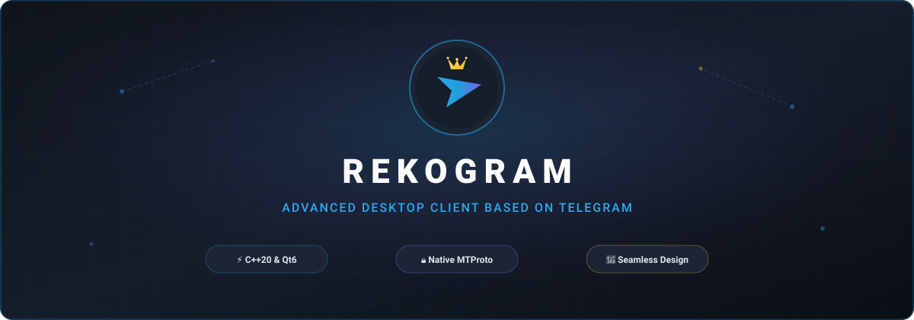

<div align="center">



# Rekogram Desktop

**Высокопроизводительный форк Telegram Desktop нового поколения.**  
*Расширенная персонализация, интеллектуальные инструменты и верность оригинальной дизайн-системе Telegram.*

<p align="center">
  <a href="https://github.com/vdyplesosiska2026-ux/Rekogram/releases">
    
  </a>
  <a href="https://github.com/vdyplesosiska2026-ux/Rekogram">
    
  </a>
  <a href="LICENSE">
    
  </a>
  <a href="https://github.com/telegramdesktop/tdesktop">
    
  </a>
  <a href="https://isocpp.org/">
    
  </a>
</p>

[О проекте](#-о-проекте) • [Возможности](#-особенности-rekogram) • [Скриншоты](#-галерея-интерфейса) • [Стек](#-технологический-стек) • [Сборка](#-инструкция-по-сборке) • [Разработка](#-разработка) • [Roadmap](#-планы-развития-roadmap) • [Безопасность](#-безопасность) • [Лицензия](#-лицензия-и-авторские-права)

---

</div>

## 📖 О проекте

**Rekogram Desktop** — это независимый форк официального клиента [Telegram Desktop](https://github.com/telegramdesktop/tdesktop), созданный для тех, кому необходим расширенный контроль над интерфейсом, сообщениями, заметками и персонализацией, без нарушения стабильности и без ухода от привычной визуальной среды.

### 🎯 Ключевые ценности
1. **100% сохранение нативного дизайна Telegram**: никакого чуждого визуала из Slack, Discord или браузерных мессенджеров. Все новые возможности используют оригинальные компоненты интерфейса (`Ui::VerticalLayout`, `Ui::Checkbox`, `Ui::PopupMenu`, палитры `.style`).
2. **Чистая и надёжная интеграция**: функции не переписывают существующую архитектуру без необходимости, гарантируя работу всех оригинальных возможностей Telegram (звонки, истории, каналы, секретные чаты, реакции).
3. **Безопасность MTProto**: полное соответствие стандартам Telegram API. Никаких изменений сетевых протоколов шифрования и передачи данных.
4. **Реальная кодовая база**: исключены любые фиктивные переключатели и декоративные заглушки. Каждая опция подкреплена реальным кодом и сохранением состояния.

---

## ⚡ Особенности Rekogram

Все функции разделены на категории и имеют строго зафиксированный статус готовности в кодовой базе.

### 🎨 Кастомизация и оформление
| Возможность | Описание | Статус |
| :--- | :--- | :---: |
| **Rekogram Settings** | Самостоятельный раздел в меню настроек, визуально отделённый от стандартного списка опций Telegram. | `Implemented` |
| **Rekogram Themes** | Быстрое и безопасное переключение тёмного/светлого оформления с подтверждением и выбором фона чата. | `Implemented` |
| **Advanced Chat List** | Компактный режим отображения списка диалогов и тонкая настройка визуальной плотности строк. | `Implemented` |
| **Advanced Theme Editor** | Экспорт, импорт и глубокая кастомизация палитр оформления сообщений. | `In Progress` |

### 🛠 Продуктивность и управление сообщениями
| Возможность | Описание | Статус |
| :--- | :--- | :---: |
| **Rekogram Bookmarks** | Быстрое сохранение важных сообщений в локальные закладки прямо из контекстного меню переписки. | `Implemented` |
| **Message Reminders** | Встроенный таймер и планировщик локальных напоминаний о сообщениях из контекстного меню. | `Implemented` |
| **Rekogram Shortcuts** | Прямой доступ к управлению и переназначению клавиатурных комбинаций клиента. | `Implemented` |
| **Settings Backup** | Надёжный экспорт и импорт пользовательской конфигурации Rekogram в формате JSON. | `Implemented` |
| **Advanced Folders** | Дополнительная кастомизация вкладок и папок чатов. | `Planned` |

### 👑 Идентичность и Интеллектуальный интерфейс
| Возможность | Описание | Статус |
| :--- | :--- | :---: |
| **Creator Badge** | Централизованная идентификация владельца по `OWNER_ID` и отображение символа создателя слева от ника. | `Implemented` |
| **Interface Lab** | Режим разработчика и переключатель экспериментальных возможностей интерфейса. | `Implemented` |
| **Rekogram AI Chat** | Архитектура изолированного AI-диалога в оригинальном дизайне переписки Telegram. | `Implemented (Demo/Arch)` |
| **Rekogram Hub** | Полный информационный центр с данными о сборке, авторстве, лицензиях и GitHub-релизах. | `Implemented` |
| **Rekogram Updater** | Система проверки новых релизов на GitHub Releases. | `Planned` |

---

## 🖼 Галерея интерфейса

Все скриншоты создаются исключительно в рабочей сборке приложения. По мере публикации релизных сборок изображения размещаются в директории [`assets/screenshots/`](assets/screenshots/):

<div align="center">

| Главный экран и список чатов | Раздел настроек Rekogram |
| :---: | :---: |
| _[ assets/screenshots/main-window.png ]_ | _[ assets/screenshots/rekogram-settings.png ]_ |

| Значок создателя (Creator Badge) | Закладки и контекстное меню |
| :---: | :---: |
| _[ assets/screenshots/creator-badge.png ]_ | _[ assets/screenshots/bookmarks.png ]_ |

</div>

---

## 💻 Технологический стек

Кодовая база Rekogram опирается на передовые индустриальные стандарты C++:

- **Язык**: `C++20` (модульная архитектура, `concepts`, современные стандартные библиотеки).
- **GUI-фреймворк**: `Qt 6` / `Qt 5.15` (с оптимизированными форками библиотеки `desktop-app`).
- **Рендеринг**: QRhi, OpenGL, ANGLE, DirectX 11/12, Vulkan, Metal.
- **Сетевой протокол**: Telegram MTProto 2.0 (клиентская реализация сетевого уровня).
- **Мультимедиа**: WebRTC (`tg_owt`), FFmpeg, OpenSSL 3.x, zlib, liblzma.
- **Сборка**: CMake 3.16+, Ninja, Visual Studio 2022 (MSVC) / GCC / Clang.

---

## 📥 Инструкция по сборке

Для самостоятельной сборки Rekogram Desktop из исходного кода используйте стандартное окружение сборки Telegram Desktop:

### 1. Подготовка окружения (Windows 64-bit)
1. Установите **Visual Studio 2022** (с пакетом инструментов *Разработка классических приложений на C++*).
2. Подготовьте зависимые библиотеки в соседнем каталоге:
   ```text
   L:\Telegram\
   ├── tdesktop\               # Этот репозиторий (Rekogram)
   ├── win64\Libraries\        # Скомпилированные 64-bit библиотеки
   └── ThirdParty\             # Инструменты сборки (Python, CMake, NASM)
   ```
3. Запустите консоль **x64 Native Tools Command Prompt for VS 2022**.

### 2. Клонирование и настройка
```cmd
git clone https://github.com/vdyplesosiska2026-ux/Rekogram.git
cd Rekogram
```

### 3. Компиляция
```cmd
cmake -B out -G "Ninja" -DCMAKE_BUILD_TYPE=Debug
cmake --build out --config Debug --target Telegram
```
*Исполняемый файл появится по пути `out/Debug/Telegram.exe` (или `Rekogram.exe`).*

> [!NOTE]  
> Подробные инструкции по подготовке зависимостей и сборке под Linux и macOS смотрите в документации [`docs/building-win.md`](docs/building-win.md) и [`docs/building-linux.md`](docs/building-linux.md).

---

## 🛠 Разработка

Мы приветствуем соблюдение чистоты архитектуры:
- Все новые компоненты Rekogram размещаются в каталоге `Telegram/SourceFiles/rekogram/`.
- Новые страницы настроек интегрируются через `Telegram/SourceFiles/settings/sections/`.
- Подробные правила контрибьюторов описаны в файле [CONTRIBUTING.md](CONTRIBUTING.md).

### Соглашение об именовании коммитов
- `feat(...)`: добавление новой функциональности;
- `fix(...)`: исправление ошибок;
- `rebrand(...)`: обновление айдентики и названий;
- `docs(...)`: обновление документации.

---

## 🗺 Планы развития (Roadmap)

```mermaid
flowchart LR
    A["v1.0.0-dev: Foundation"] --> B["v1.1.0: Advanced UX"]
    B --> C["v1.2.0: AI Engine Integration"]

    subgraph A["Выполнено (Completed)"]
        direction TB
        A1["Базовый ребрендинг в Rekogram"]
        A2["Раздел «Настройки Rekogram»"]
        A3["Creator Badge система (OWNER_ID)"]
        A4["Закладки сообщений (Bookmarks)"]
        A5["Напоминания о сообщениях (Reminders)"]
        A6["Резервная копия настроек в JSON"]
    end

    subgraph B["В процессе (In Progress)"]
        direction TB
        B1["Расширенный редактор палитры тем"]
        B2["Управление папками чатов"]
        B3["Слайдер скругления аватаров"]
    end

    subgraph C["Запланировано (Planned)"]
        direction TB
        C1["Подключение внешних LLM API к AI Chat"]
        C2["Автоматический апдейтер через GitHub Releases"]
    end
```



---

## 📜 История изменений (Changelog)

- **v1.0.0-dev** (текущая версия):
  - Полноценная инициализация репозитория Rekogram.
  - Интеграция секции настроек `Settings::RekogramSection`.
  - Модули `BookmarksManager`, `RemindersManager`, `BackupManager`.
  - Архитектура `AIChatManager` с демо-режимом переписки.
  - Централизованный рендеринг `Creator Badge`.

*Подробную историю изменений смотрите в файле [CHANGELOG.md](CHANGELOG.md).*

---

## 🔒 Безопасность

Проект придерживается строгой политики приватности данных:
- В репозитории не хранятся и никогда не публикуются персональные токены, пароли, секретные ключи или рабочие `API_ID` / `API_HASH`.
- Конфигурационный параметр `OWNER_ID` отвечает исключительно за декоративное отображение значка создателя в интерфейсе и не предоставляет привилегий доступа к чужим сессиям.
- При обнаружении уязвимостей безопасности создавайте приватный Security Advisory через GitHub.

---

## ⚖ Лицензия и авторские права

Проект **Rekogram Desktop** лицензирован на условиях **GNU General Public License v3.0 with OpenSSL Exception**.

- **Telegram Desktop**: Copyright (c) 2014-2026 Telegram Desktop authors.  
  Официальный репозиторий: [github.com/telegramdesktop/tdesktop](https://github.com/telegramdesktop/tdesktop)
- **Rekogram**: Развивается как открытый форк.

---

<div align="center">

**[Rekogram Desktop GitHub Repository](https://github.com/vdyplesosiska2026-ux/Rekogram)**  
*Crafted with precision for the modern desktop.*

</div>
