```mermaid
flowchart LR
    A["v1.0.0-dev: База"] --> B["v1.1.0: Расширенный UX"]
    B --> C["v1.2.0: AI-движок"]

    subgraph A["Реализовано"]
        direction TB
        A1["Айдентика и константы Rekogram"]
        A2["Раздел «Настройки Rekogram»"]
        A3["Creator Badge с проверкой OWNER_ID"]
        A4["Закладки сообщений (Bookmarks)"]
        A5["Напоминания о сообщениях (Reminders)"]
        A6["Резервная копия настроек в JSON"]
    end

    subgraph B["В процессе"]
        direction TB
        B1["Расширенный редактор палитры тем"]
        B2["Кастомизация отображения папок"]
        B3["Управление скруглением аватаров"]
    end

    subgraph C["Запланировано"]
        direction TB
        C1["Подключение внешних LLM к AI Chat"]
        C2["Автоматический апдейтер через GitHub"]
    end
```

<div align="center">


# Rekogram Desktop

**Telegram, переосмысленный.**  
*Высокопроизводительный нативный десктоп-клиент на C++20 с расширенной персонализацией, удобными инструментами продуктивности и абсолютным сохранением дизайна Telegram Desktop.*

<p align="center">
  <a href="https://github.com/vdyplesosiska2026-ux/Rekogram/releases">
    
  </a>
  <a href="https://github.com/vdyplesosiska2026-ux/Rekogram">
    
  </a>
  <a href="LICENSE">
    
  </a>
  <a href="https://github.com/telegramdesktop/tdesktop">
    
  </a>
  <a href="https://isocpp.org/">
    
  </a>
</p>

[О проекте](#-о-проекте) • [Возможности](#-возможности-rekogram) • [Галерея интерфейса](#-галерея-интерфейса) • [Стек технологий](#-технологический-стек) • [Сборка](#-инструкция-по-сборке) • [Разработка](#-разработка) • [Roadmap](#-планы-развития-roadmap) • [Безопасность](#-безопасность) • [Лицензия](#-лицензия-и-авторские-права)

---

</div>

##  О проекте

**Rekogram Desktop** — это независимый форк официального приложения [Telegram Desktop](https://github.com/telegramdesktop/tdesktop). Проект создан для пользователей и энтузиастов, которым необходим глубокий контроль над интерфейсом, удобные закладки сообщений, встроенные напоминания и гибкие настройки без компромиссов в стабильности и без искажения оригинальной эстетики мессенджера.

### Ключевые принципы:
- **Аутентичность дизайна**: Никаких заимствований стилей из сторонних приложений. Все новые разделы, всплывающие окна и кнопки используют родные компоненты Telegram (`Ui::VerticalLayout`, `Ui::Checkbox`, `Ui::PopupMenu`, фирменные стили `.style`).
- **Архитектурная надёжность**: Стабильность официального клиента Telegram не нарушена — голосовые и видеозвонки, истории, MTProto 2.0, секретные чаты и реакции работают без изменений.
- **Никаких пустых элементов**: Каждая кнопка, переключатель и пункт меню подкреплены реальным C++ кодом с сохранением состояния между перезапусками приложения.

---

##  Возможности Rekogram

Все функции разделены по направлениям и имеют точный статус реализации в кодовой базе.

### Внешний вид и темы
| Возможность | Описание | Статус |
| :--- | :--- | :---: |
| **Настройки Rekogram** | Выделенный экран конфигурации в главном меню, визуально отделённый от стандартного списка настроек Telegram. | `Реализовано` |
| **Темы и ночной режим** | Быстрое и безопасное переключение темного/светлого режима с диалогом подтверждения и выбором фона чатов. | `Реализовано` |
| **Компактный список чатов** | Оптимизированный режим плотности строк в списке диалогов и сохранение настроек вида. | `Реализовано` |
| **Редактор палитр** | Глубокая настройка цветовых схем оформления сообщений с возможностью импорта и экспорта. | `В разработке` |

### Продуктивность и работа с сообщениями
| Возможность | Описание | Статус |
| :--- | :--- | :---: |
| **Закладки Rekogram** | Сохранение важных сообщений в локальные закладки прямо из контекстного меню переписки. | `Реализовано` |
| **Напоминания о сообщениях** | Установка отложенных локальных напоминаний на выбранное сообщение из меню действий. | `Реализовано` |
| **Горячие клавиши** | Прямой доступ к управлению и переназначению клавиатурных комбинаций приложения. | `Реализовано` |
| **Резервная копия настроек** | Экспорт и импорт пользовательской конфигурации в формате JSON с валидацией схемы и версий. | `Реализовано` |
| **Расширенные папки** | Дополнительные параметры порядка, цветовых обозначений и сортировки вкладок чатов. | `Запланировано` |

### Идентичность и Интеллектуальный интерфейс
| Возможность | Описание | Статус |
| :--- | :--- | :---: |
| **Значок создателя (Creator Badge)** | Централизованная проверка `OWNER_ID` и отображение символа создателя слева от имени пользователя. | `Реализовано` |
| **Лаборатория интерфейса** | Режим разработчика и тумблер включения экспериментальных возможностей интерфейса. | `Реализовано` |
| **Rekogram AI Chat** | Архитектура и интерфейс отдельного чата с поддержкой локальной истории сообщений в дизайне Telegram. | `Реализовано (Архитектура)` |
| **Rekogram Hub** | Информационный раздел со сведениями о сборке, происхождении форка, лицензиях и ссылкой на GitHub. | `Реализовано` |
| **Обновления Rekogram** | Проверка свежих версий через GitHub Releases без навязчивой автоустановки. | `Запланировано` |

### Rekogram Local Premium
| Возможность | Клиентский механизм | Статус |
| :--- | :--- | :---: |
| **Custom Emoji Picker** | Полная разблокировка выбора и вставки любых анимированных кастомных эмодзи | `Available (Доступно)` |
| **Увеличенные лимиты** | GIF: 400, стикеры: 10, папки: 30, закрепленные чаты: 10/200, подписи: 2048, био: 140 | `Available (Доступно)` |
| **Свободный порядок папок** | Перемещение любых вкладок диалогов, включая вкладку «Все чаты» | `Available (Доступно)` |
| **Видеоаватары** | Полноэкранный просмотр и воспроизведение анимированных аватаров профиля | `Available (Доступно)` |
| **Векторный бейдж статуса** | Эксклюзивный кристаллический знак статуса Rekogram Local Premium | `Available (Доступно)` |
| **Анимированные реакции** | Клиентское воспроизведение расширенных реакций и анимаций | `Partially Available` |
| **Анимированные эмодзи в чатах** | Отправка в Избранное/каналы/темы; в ЛС зависит от серверных правил Telegram | `Partially Available` |
| **Файлы до 4 ГБ / Голос в текст** | Требует серверного флага Telegram Premium на стороне Telegram backend | `Server Required` |

---

##  Галерея интерфейса

Официальные скриншоты интерфейса размещаются в каталоге [`assets/screenshots/`](assets/screenshots/):

<div align="center">

| Главный экран и список чатов | Экран настроек Rekogram |
| :---: | :---: |
| _[ `assets/screenshots/main-window.png` ]_ | _[ `assets/screenshots/rekogram-settings.png` ]_ |

| Значок создателя (Creator Badge) | Закладки в контекстном меню |
| :---: | :---: |
| _[ `assets/screenshots/creator-badge.png` ]_ | _[ `assets/screenshots/bookmarks.png` ]_ |

</div>

---

##  Технологический стек

Кодовая база Rekogram опирается на современные индустриальные стандарты C++:

- **Язык**: `C++20` (модульная архитектура, строгая типизация, современные библиотеки).
- **GUI-фреймворк**: `Qt 6` / `Qt 5.15` с аппаратно-ускоренным рендерингом (QRhi, OpenGL, DirectX, Metal, Vulkan).
- **Сетевой стек**: Оригинальная клиентская имплементация протокола Telegram MTProto 2.0.
- **Мультимедиа**: WebRTC (`tg_owt`), FFmpeg, OpenSSL 3.x, zlib, liblzma.
- **Сборка**: CMake 3.16+, Ninja, Visual Studio 2022 (MSVC) / GCC / Clang.

---

##  Инструкция по сборке

Сборка исходного кода Rekogram Desktop выполняется в стандартном окружении Telegram Desktop:

### Сборка на Windows (64-bit)

1. Установите **Visual Studio 2022** с компонентами *Разработка классических приложений на C++*.
2. Подготовьте зависимые библиотеки в соседнем каталоге согласно структуре:
   ```text
   L:\Telegram\
   ├── tdesktop\               # Каталог репозитория (Rekogram)
   ├── win64\Libraries\        # Скомпилированные 64-bit зависимости
   └── ThirdParty\             # Инструменты сборки (Python, CMake, NASM)
   ```
3. Откройте консоль **x64 Native Tools Command Prompt for VS 2022**.
4. Склонируйте и соберите проект:
   ```cmd
   git clone https://github.com/vdyplesosiska2026-ux/Rekogram.git
   cd Rekogram
   cmake -B out -G "Ninja" -DCMAKE_BUILD_TYPE=Debug
   cmake --build out --config Debug --target Telegram
   ```

*Подробные руководства по подготовке зависимостей и сборке под Linux и macOS смотрите в [`docs/building-win.md`](docs/building-win.md) и [`docs/building-linux.md`](docs/building-linux.md).*

---

##  Разработка

Мы поддерживаем чистоту архитектуры и модульность:
- Все специализированные компоненты Rekogram находятся в каталоге `Telegram/SourceFiles/rekogram/`.
- Новые подразделы настроек размещаются в `Telegram/SourceFiles/settings/sections/`.
- Порядок внесения изменений описан в файле [CONTRIBUTING.md](CONTRIBUTING.md).

### Оформление коммитов
- `feat(...)`: добавление новых возможностей;
- `fix(...)`: исправление ошибок;
- `rebrand(...)`: обновление названий и айдентики;
- `docs(...)`: изменения в документации.

---

##  Планы развития (Roadmap)



---

##  Безопасность

Проект придерживается строгой политики защиты пользовательских данных:
- В репозитории не хранятся пароли, токены, секретные ключи или реальные `API_ID` / `API_HASH`.
- Конфигурационный параметр `OWNER_ID` отвечает исключительно за декоративное отображение значка создателя в интерфейсе и не даёт никаких административных прав или привилегий доступа.
- Об уязвимостях сообщайте через приватный канал Security Advisories на GitHub.

---

##  Лицензия и авторские права

Проект **Rekogram Desktop** лицензирован на условиях **GNU General Public License v3.0 with OpenSSL Exception**. Подробный текст доступен в файле [LICENSE](LICENSE).

- **Telegram Desktop**: Copyright (c) 2014-2026 Telegram Desktop authors.  
  Официальный репозиторий: [github.com/telegramdesktop/tdesktop](https://github.com/telegramdesktop/tdesktop)
- **Rekogram**: Развивается как открытый форк.

---

<div align="center">

**[Репозиторий Rekogram Desktop на GitHub](https://github.com/vdyplesosiska2026-ux/Rekogram)**  
*Telegram, переосмысленный.*

</div>
